# Antigravity Implementation Plan & Staged Roadmap

This document outlines the ordered implementation roadmap for the Nior Business Automation and AI Website Agent system, tracking phase status, criteria, and execution gates.

---

## Roadmap Overview

```mermaid
graph LR
    S1[Stage 1: Core Foundation & QA] --> S2[Stage 2: Operational Orchestration]
    S2 --> S3[Stage 3: Approved Outbound & Intake]
    S3 --> S4[Stage 4: Social Media Engine]
    S4 --> S5[Stage 5: Multi-Channel Expansion]
    S5 --> S6[Stage 6: Dedicated n8n Workflows]
    S6 --> S7[Stage 7: Production Cloud Deployment]
    S7 --> S8[Stage 8: Security Audit & Live Acceptance]
```

---

## Stage Breakdown & Status

### Stage 1: Core Website Pipeline & QA Release Gate
- **Status**: **COMPLETE (Verified Green)**
- **Deliverables**:
  - Modular Scout discovery agent (Overpass OSM & Tavily).
  - Grounded Research Agent with uncertainty tags.
  - Semantic HTML component library & templates.
  - Deterministic Website Builder with LLM copy fallback.
  - 14-point Quality QA validator (Release Gate).
  - Isolated Vercel Preview Deployer with append-only ledger.

### Stage 2: Orchestration, Health & Human Review Controls
- **Status**: **COMPLETE (Verified Green)**
- **Deliverables**:
  - `TrackingStore` persistence (SQLite + Supabase PostgreSQL schema).
  - Application-owned `JobService` state machine with worker leases.
  - Stale job detection and heartbeat recovery.
  - Comprehensive health and operator attention reporting.
  - Interactive Telegram Operator Console (24 commands).

### Stage 3: Two-Tier Gmail Integration & Approved Outbound
- **Status**: **COMPLETE (Verified Green)**
- **Deliverables**:
  - Isolated `gmail.readonly` inbox response ingestion.
  - Dedicated `gmail.send` outbound send client on shared transport.
  - Content-fingerprint bound proposal approval gate.
  - n8n exported workflows 01 to 07.
  - **Operator Prerequisite**: Configure second OAuth client for live sending.

### Stage 4: Social Media Engine & Buffer/Botcake Integration
- **Status**: **COMPLETE (Verified Green)**
- **Objectives**:
  - [x] Audit live n8n Buffer & Botcake workflows.
  - [x] Document platform pricing, rate limits, and zero-cost routes (`docs/PLATFORM_CAPABILITIES.md`).
  - [x] Develop unified `social/` content generator module with brand voice adherence.
  - [x] Implement local persistence and lifecycle tracking in `social/service.py`.
  - [x] Implement Telegram `/post` and `/social` interactive draft generation, review, and approval loop.
  - [x] Connect Python social draft queue to n8n Buffer Draft Executor (`zAd3P31ZrTm9Ax94`).

### Stage 5: Multi-Channel Expansion & Operations Scaling
- **Status**: **COMPLETE (Verified Green)**
- **Objectives**:
  - [x] Expand template registry: Healthcare/Clinic (`clinic-healthcare-v1`), Legal/Professional (`legal-practice-v1`), Automotive (`automotive-service-v1`).
  - [x] Create fictional demo data fixtures (`templates/demo-data/demo_{clinic,legal,automotive}.json`) with static QA 100% score (PASS).
  - [x] Implement automated daily business briefing generator matching live n8n workflow `loO3tTJlt6aFdhvb` rules (`orchestration/briefing.py`).
  - [x] Implement Telegram `/briefing` and `/daily` operator commands with message chunking (<= 3900 characters).
  - [x] Validate read-only Supabase PostgreSQL connection preflight diagnostics (`tracking.cli preflight-db`).
  - [x] Verify full test suite: **708 passed, 1 skipped, 0 failures across 709 tests**.

### Stage 6: Dedicated n8n Workflow Deployment & Live End-to-End Integration
- **Status**: **COMPLETE (Verified Green & Inactive)**
- **Objectives**:
  - [x] Build and deploy Workflow 01 (`01 - Nior Website Agent: Job Lifecycle & Pipeline Runner`, ID: `YaH7bhvuxxnnH7yt`) via n8n MCP; verified with execution test `16614` (SUCCESS).
  - [x] Build and deploy Workflow 02 (`02 - Nior Operations: Daily Business Briefing & Alerts`, ID: `eRAS3vC1wq19zaYu`) with Africa/Lagos schedule; verified with execution test `16617` (SUCCESS).
  - [x] Build and deploy Workflow 03 (`03 - Nior Social Engine: Buffer Multi-Channel Publisher`, ID: `hgLCDChiBiJhooUE`) with fingerprint & channel verification; verified with execution test `16621` (SUCCESS).
  - [x] Build and deploy Workflow 04 (`04 - Nior Communications: Inbound Ingestion & Intake Router`, ID: `gWXFx91CdFmvH45R`) for read-only intake polling; verified with execution test `16623` (SUCCESS).
  - [x] Build and deploy Workflow 05 (`05 - Nior Outbound: Approved Send with Fingerprint Gate`, ID: `UbKxQXbz5Q7PSxQs`) with fail-closed dry-run; verified with execution test `16626` (SUCCESS).
  - [x] Export secret-free JSON definitions to `n8n/workflows/project/01..05-*.json`.
  - [x] Document workflow specifications, credentials, and network requirements in `docs/WORKFLOW_INTEGRATION.md`.
  - [x] Maintain all 5 workflows in verified `active: false` state.

### Stage 7: Production Cloud Deployment & Live Database Migration
- **Status**: **COMPLETE (Verified Live & Green)**
- **Objectives**:
  - [x] Integrate PostgreSQL transactional persistence with live Supabase database via session pooler (`aws-0-us-east-1.pooler.supabase.com:5432`).
  - [x] Apply production schema migration `0001_supabase_postgres_schema.sql` (all tables, indexes, and RLS created).
  - [x] Configure and deploy Render Web Service (`srv-db7cartg1s2s739vrasg` at `https://ai-website-agent-api.onrender.com`).
  - [x] Verify live public health probe (`GET /healthz` -> `HTTP 200 {"status": "ok"}`).
  - [x] Verify authenticated readiness probe (`GET /readiness` -> `HTTP 200 {"status": "READY", "storage_backend": "postgres", "production_mode": true}`).
  - [x] Verify transactional persistence against Supabase PostgreSQL (`GET /jobs`).

### Stage 8: Production Security, Live Integration Acceptance & Operational Readiness
- **Status**: **COMPLETE (Verified Live & Green)**
- **Objectives**:
  - [x] **Credential Rotation (Priority 0)**: Rotated exposed API bearer token (`AI_WEBSITE_AGENT_API_TOKEN`) on Render to a cryptographically secure 43-character token; verified old token refusal (`HTTP 401`) and new token acceptance (`HTTP 200`); verified zero leaked credentials in git repository.
  - [x] **Independent Render & Supabase Live Verification (Priority 1)**: Verified `GET /healthz` (`HTTP 200 {"status": "ok"}`) unauthenticated; verified `GET /readiness` (`HTTP 200 {"status": "READY", "storage_backend": "postgres", "production_mode": true}`); verified auth refusals on missing/invalid headers and unsupported HTTP verbs (`HTTP 401` / `405`); verified transactional persistence, idempotency, and restart survival via live test job (`stage8-verify-1792557783`); verified Supabase PostgreSQL Row Level Security (RLS) active across all 11 tables.
  - [x] **Dedicated n8n Workflow Verification (Priority 2)**: Verified all 5 dedicated workflows preserved in `active: false` state.
  - [x] **Controlled Pipeline Smoke Tests (Priority 3)**: Executed Test A Website Pipeline (36 passed), Test B Social Pipeline (21 passed), Test C Inbound Intake (32 passed), Test D Approved Outbound Gate (97 passed). Total: 186 passed.
  - [x] **Operator Console Readiness (Priority 4)**: Verified Telegram bot command parser, allowlists, and notification gates (86 passed).
  - [x] **Operational & Security Runbook Documentation (Priority 5 & 6)**: Documented credential rotation, Supabase backup/restore procedures, and operator command cheat sheet in `docs/OPERATIONS_RUNBOOK.md` and `docs/ENVIRONMENT_AND_SECRETS.md`.

### Stage 9: Dedicated n8n Instance Provisioning & Workflow Import
- **Status**: **COMPLETE (Verified Live & Green)**
- **Objectives**:
  - [x] Deploy fresh dedicated n8n web service on Render at `https://ai-website-agent-n8n.onrender.com` (isolated from legacy 20-workflow instance).
  - [x] Configure production credentials on dedicated instance: `AI Website Agent API` (Header Auth) and `Telegram Operator Bot` (telegramApi).
  - [x] Import canonical workflows 01 to 05 with node credentials attached:
    - 01: `2If2517dlZ6VgMRG`
    - 02: `VMZ7hjZvUySNXI5r`
    - 03: `JX8JOIsKsTzCeZ71`
    - 04: `xKAaIpgsj09HH8nK`
    - 05: `kGNApQItCjQ5CNeu`
  - [x] Verify all workflows maintain `active: false` state.

### Stage 10: Integration Validation, Controlled Automation & System Hardening
- **Status**: **COMPLETE (Verified Green)**
- **Objectives**:
  - [x] Audit remote n8n workflow definitions and node connections against canonical exports in `n8n/workflows/project/`.
  - [x] Establish integration acceptance matrix and automated test suite (`tests/test_stage10_integration_acceptance.py`, 14 tests).
  - [x] Verify API contracts: authentication, input validation, idempotency, failure boundaries, and hold gates.
  - [x] Resolve calendar timing sensitivity in `tests/test_briefing.py` via deterministic Lagos timezone mocking.
  - [x] Verify full test suite regression-free: **722 passed, 1 skipped, 0 failures across 723 tests**.
  - [x] Enforce controlled execution policy: all 5 workflows preserved inactive (`active: false`) until operator activation.
  - [x] Prepare comprehensive Stage 10 report and transition criteria for the final website-template stage.

### Final Stage: Reusable Website Template & Production Presentation
- **Status**: **COMPLETE (Verified Green)**
- **Objectives**:
  - [x] Complete CSS overhaul: premium typography (DM Serif Display + Inter), HSL-tuned color palette, glassmorphism accents, micro-animations, gradient hero sections, polished card hover effects, enhanced responsive breakpoints.
  - [x] Add 6th template: `retail-ecommerce-v1` for retail stores, boutiques, fashion, and e-commerce businesses with product showcase and dual products+services sections.
  - [x] Enrich all 6 demo fixtures with 4-5 services/items each and richer fictional descriptions.
  - [x] Maintain clean data separation: business data, brand CSS custom properties, and layout components remain independent.
  - [x] All 6 templates pass 14-point static QA validator at 100/100 PASS.
  - [x] Comprehensive test suite: `tests/test_final_template.py` (44 tests) covering registry, fixtures, rendering, QA compliance, data separation, CSS foundation, and edge cases.
  - [x] Full test suite regression-free.
