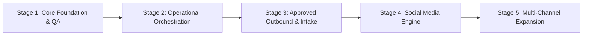

# Antigravity Implementation Plan & Staged Roadmap

This document outlines the ordered implementation roadmap for the Nior Business Automation and AI Website Agent system, tracking phase status, criteria, and execution gates.

---

## Roadmap Overview

---

## Stage Breakdown & Status

### Stage 1: Core Website Pipeline & QA Release Gate
- **Status**: **COMPLETE (Verified Green)**
- **Deliverables**:
  - Modular Scout discovery agent (Overpass OSM & Tavily).
  - Grounded Research Agent with uncertainty tags.
  - Semantic HTML component library & templates.
  - Deterministic Website Builder with LLM copy fallback.
  - 14-point Quality QA validator (Release Gate).
  - Isolated Vercel Preview Deployer with append-only ledger.

### Stage 2: Orchestration, Health & Human Review Controls
- **Status**: **COMPLETE (Verified Green)**
- **Deliverables**:
  - `TrackingStore` persistence (SQLite + Supabase PostgreSQL schema).
  - Application-owned `JobService` state machine with worker leases.
  - Stale job detection and heartbeat recovery.
  - Comprehensive health and operator attention reporting.
  - Interactive Telegram Operator Console (24 commands).

### Stage 3: Two-Tier Gmail Integration & Approved Outbound
- **Status**: **COMPLETE (Verified Green)**
- **Deliverables**:
  - Isolated `gmail.readonly` inbox response ingestion.
  - Dedicated `gmail.send` outbound send client on shared transport.
  - Content-fingerprint bound proposal approval gate.
  - n8n exported workflows 01 to 07.
  - **Operator Prerequisite**: Configure second OAuth client for live sending.

### Stage 4: Social Media Engine & Buffer/Botcake Integration
- **Status**: **IN PROGRESS**
- **Objectives**:
  - [x] Audit live n8n Buffer & Botcake workflows.
  - [x] Document platform pricing, rate limits, and zero-cost routes (`docs/PLATFORM_CAPABILITIES.md`).
  - [ ] Develop unified `social/` content generator module with brand voice adherence.
  - [ ] Add content calendar schema to `TrackingStore`.
  - [ ] Implement Telegram `/post` interactive draft generation and review loop.
  - [ ] Connect Python social draft queue to n8n Buffer Draft Executor (`zAd3P31ZrTm9Ax94`).

### Stage 5: Multi-Channel Expansion & Operations Scaling
- **Status**: **PLANNED**
- **Objectives**:
  - Expand template registry: Healthcare/Clinic, Legal/Professional, Automotive.
  - Implement automated daily business briefing generator via Telegram bot.
  - Integrate live Supabase PostgreSQL connection in production mode.
  - Deploy remote orchestration container to Render.
