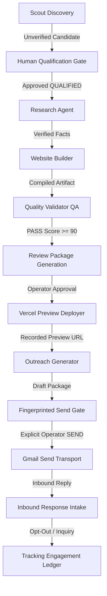

# Nior System Architecture & Engineering Specifications

This document outlines the architectural topology, core contracts, data persistence model, and security boundaries of the Nior Business Automation & AI Website Agent System.

---

## 1. System Mission & Operating Constraints

Nior is an automated business operating and outreach system tailored for local businesses in Nigeria (and emerging markets). It operates under strict operational and ethical mandates:

1. **Zero Fabrication**: Real public business discovery records (`REAL_PUBLIC_DATA`) are never blended with fictional test fixtures (`TEST_FIXTURE`). No testimonials, staff profiles, pricing, or business hours are invented.
2. **Deterministic Fallbacks**: Every AI generation adapter (Groq, OpenRouter, Nemotron) sits behind strict schema validation with deterministic template fallbacks.
3. **Fail-Closed Authorization Gates**:
   - Discovery data is **review-only** by default.
   - Websites cannot be built without verified qualification.
   - Deployments cannot execute without a matching build manifest, a Phase 6 quality `PASS`, and explicit human review approval.
   - Outbound messaging cannot send without explicit human approval bound to a cryptographic content fingerprint.

---

## 2. Component Topology & Package Map

```
c:\Users\PC\Documents\GitHub\AI-website-Agent\
├── scout/               # Multi-source candidate discovery & enrichment
│   ├── scout_agent.py   # Overpass (OSM), Places, Tavily enricher protocol
│   ├── tavily_enrichment.py # Bounded search enrichment
│   └── cli.py           # Scout CLI with approval flags
├── research/            # Evidence-grounded business analysis
│   ├── research_agent.py# Fact extraction, website quality heuristics
│   └── live_source.py   # Public web page reader with rate limiting
├── opportunities/       # Assessment bridge from Scout to Builder
│   └── assessment.py    # Opportunity scoring and qualification gates
├── templates/           # Semantic HTML/CSS component templates
│   ├── registry.py      # Template registry (restaurant, salon, professional)
│   └── components/      # Responsive, zero-dependency layout primitives
├── builder/             # Static website generator
│   ├── builder.py       # Deterministic compiler
│   └── content_generator.py # Provider-agnostic LLM copy adapter
├── validation/          # Static QA and compliance gate
│   └── quality_validator.py # 14-point linting, SEO, mobile, disclosure checks
├── deployment/          # Preview deployment engine
│   ├── deployer.py      # Isolated Vercel preview adapter
│   └── authorization.py # Append-only deployment ledger & gate
├── tracking/            # Durable local & remote state store
│   ├── store.py         # TrackingStore (SQLite / Supabase Postgres)
│   ├── engagement.py    # Customer relationship & proposal ledger
│   └── inbound.py       # Inbound response parser & opt-out triaging
├── outreach/            # Personalized draft package creator
│   └── service.py       # Fingerprinted outreach generator
├── integrations/        # External platform transports
│   ├── http.py          # Resilient HTTP client with retry/backoff
│   ├── gmail.py         # Read-only Gmail polling adapter
│   ├── gmail_send.py    # Isolated gmail.send adapter (fingerprinted)
│   └── telegram.py      # Telegram Bot API transport
└── orchestration/       # Automation, jobs, health, and CLI console
    ├── jobs.py          # JobService, state machine, worker leases
    ├── workers.py       # WorkerRegistry & capability router
    ├── outbound.py      # ApprovedOutboundSender gate
    ├── telegram_bot.py  # 24-command operator console
    ├── health.py        # System health, readiness, and alert engine
    └── api.py           # Bearer-token protected REST API
```

---

## 3. Data Flow & Lifecycle State Machine



### State Transitions & Durable Records

1. **Leads**: `DISCOVERED` → `NEEDS_REVIEW` → `QUALIFIED` (or `SKIPPED` / `DISQUALIFIED`).
2. **Projects**: `CREATED` → `BUILDING` → `READY_FOR_REVIEW` → `APPROVED_FOR_PREVIEW` → `DEPLOYED`.
3. **Outreach**: `DRAFT` → `APPROVED` → `PRE_ATTEMPT_MARKED` → `ACCEPTED_BY_PROVIDER` (or `SEND_FAILED` / `SEND_UNCERTAIN`).

---

## 4. Security & Isolation Architecture

- **No Shared Credentials**: Read-only Gmail ingestion and outbound `gmail.send` use strictly isolated scopes and credentials.
- **Canary Redaction**: Diagnostic sanitizers strip passwords, database connection strings, bearer tokens, and customer emails from logs and API payloads.
- **Local Isolation**: Subprocess testing environments strip global CLI paths to guarantee reproducibility across differing operator machines.
- **Database Boundary**: DDL migrations require explicit confirmation containing the discovered database target name to prevent accidental execution against production databases.
